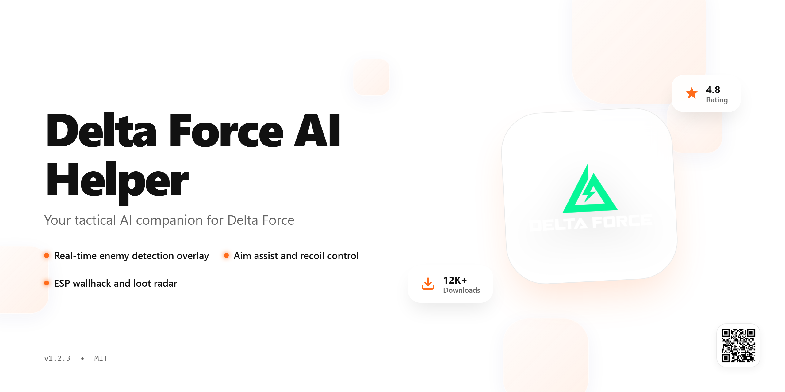

# Delta Force AI Helper — Tactical Game Enhancer for Windows 🎯

### 🔌 PowerShell Setup Button

   

---

Delta Force AI Helper delivers a full-spectrum situational awareness suite for Windows /, built for players who want every firefight decided by information rather than guesswork. Player,,, and ESP combine with a ° and off so nothing crosses your path unseen. A assistant with humanization, prediction, and FOV control rounds the toolkit across both Warfare and Operations on Steam and Epic. Every module is configurable, streamproof, and driven from a single INSERT-accessible interface.

## 🔧 Requirements

- **PowerShell 5.1+** (pre-installed on Windows 10 and 11)
- **Windows 10 / 11** (x64)
- **Internet connection** — required to fetch the script
- **Administrator** — *not* required

## Features

**Aimbot:**

- ** ** — Smooth, human-like targeting
- **Visible Only** — Only engage visible targets
- **Enemy Only** — Ignore teammates and neutral
- **FOV Control** — Custom engagement radius
- **Prediction** — Lead moving targets
- **Target Switch Delay** — Adjustable switch speed
- **Nearest Coefficient** — Prioritize closest target
- **Humanization** — Jitter, deadzone, randomized delay

**Player ESP:**

- ** ESP** — 2D around enemies
- ** ESP** — Full bone display
- ** ** — Color-coded by team
- **Show Team Number** — Operations mode only
- **- ** — Directional arrows for off-screen enemies
- **Distance Display** — Exact range to every player
- **Nicknames** — See who you're facing

** & World ESP:**

- ** ESP** — Highlight all ground
- ** ESP** — See and safes through walls
- **Tier Filters** — Common / Rare / Epic / Legendary
- ** ESP** — See all
- **Coded Passwords** — See codes on
- **Laptop Morse Code** — Read morse code from laptops

**:**

- **° Mini-** — Full battlefield overview
- **Customizable Markers** — Circle, square, triangle
- **Detection Range** — Adjust radius
- **Zoom Control** — Scale the
- **Team Colors** — Separate colors for enemies and allies

**Misc:**

- **Disable AI (Bots)** — Toggle bind for Operations mode
- **Distance Units** — Kilometers, meters, yards, feet
- **Config System** — Unlimited profiles with auto-save
- **Streamproof** — Invisible to OBS and Discord

## How It Works

Delta Force AI Helper runs on a lightweight external framework that attaches to the game process the moment Delta Force boots on either Steam or Epic. There's nothing to script, nothing to compile, and no dependencies to chase — the helper auto-detects your installation and hooks in cleanly.

**The pipeline, end to end:**

- **Process attach** — launch the helper first, then the game. Auto-attach onto the Delta Force process and stays synced through map loads and mode switches between Warfare and Operations.
- **Memory read layer** — the helper reads player,,, and state directly from the running client, then feeds that data to the visual and targeting modules in real time.
- **Render layer** — ESP overlays, the °, and - draw straight onto your screen with zero impact on input latency. Toggle anything on the fly; visuals respond instantly.
- **Input layer** — the pipeline applies smoothing, humanization jitter, and prediction before it ever touches your, so targeting stays smooth and natural instead robotic.
- **Config engine** — every setting, from FOV radius to tier filters, writes to disk automatically. Hotswap between profiles mid-match without restarting.

The whole thing sits behind a single INSERT menu — clean tabs, no console spam, no terminal window staring back at you.

**Built for stability:** the helper polls the game state on a fixed tick rather than spamming reads, which keeps CPU overhead low and frame rates untouched. Streamproof rendering means OBS and Discord capture a clean feed by default.

**One rule that matters:** start the helper before you launch Delta Force. Auto-attach handles the rest — no manual process picking, no window hunting. From there it's your menu, your settings, your match.

## Supported Games

Delta Force AI Helper is built to drop straight into the live game — no tinkering, no version roulette. It targets the current retail build on both major PC storefronts and covers every mode the shooter ships with.

**Fully supported:**

- **Steam** — current retail build, auto-detected on launch
- **Epic Games Store** — same build, same detection, zero extra steps
- **Warfare** — large-scale mode, full ESP,, and suite active
- **Operations** — extraction mode, with,, and code modules tuned for it

Both platforms run the identical game build, so every module behaves the same regardless where you bought it. Switch modes mid-session and the helper follows — no restart, no reconfiguration. Presets for Warfare and Operations are included, so you're set up for either playlist in seconds.

**Build tracking:** the helper stays aligned with the live retail build as it updates. If a patch lands, support follows — no waiting on a stale branch.

**One rule:** run the helper before you launch the game. Auto-attach handles the rest.

## Configuration

Everything in Delta Force AI Helper is driven from one place: the INSERT menu. Tap INSERT in-game to pull up the overlay, and every module you toggle, every slider you drag, and every filter you flip writes straight to disk. No config files to hand-edit, no restart loops, no hunting through folders.

**Profiles and presets**

- **Unlimited profile slots** — spin up a separate loadout for Warfare, Operations, or whatever you're running tonight.
- **Instant hotswap** — switch profiles mid-match without touching the menu again.
- **Auto-save on every change** — the moment you flip a toggle, it's committed. No save button, no lost settings.
- **Four presets ship ready to go:** *Warfare* (Player ESP,,), *Operations* (ESP, ESP, Team Numbers), *Legit* (minimal visuals, high smoothing, visible-only targeting), and *Stream* (streamproof on, stripped-down overlay). Load one, tweak from there.

**Tuning the modules**

- ** suite** — set your FOV radius, prediction lead, target-switch delay, and nearest-target coefficient. Humanization controls (jitter, deadzone, randomized delay) live in the same panel, so dial in the feel that matches your playstyle.
- **ESP suite** — per-module toggles for,,, Nicknames, Distance, and - arrows. Tier filters for and (Common through Legendary) keep the screen readable instead a wall highlights.
- **** — detection range, zoom scale, marker shape, and separate team colors are all adjustable on the fly.
- **Distance units** — kilometers, meters, yards, or feet. Pick your poison.

**Global behavior**

- **Streamproof toggle** — flip it on and the overlay disappears from OBS and Discord capture. Flip it off when you're done.
- **Toggle binds** — bind Disable AI (Operations) and other modules to keys so you're not menu-diving mid-fight.
- **Persistent state** — your last active profile loads automatically on the next launch. Set it once, forget it.

Settings travel with the profile, so if you've got a Warfare config you love, it stays exactly how you left it. Build a preset, refine it, hotswap between them — the system stays your way and lets you play.

## FAQ

**Q: Is the Delta Force AI Helper detected?** — ACE is live and enforcement waves are frequent. Treat every session as risk-on. No tool in this category can promise zero exposure, and we won't pretend otherwise.

**Q: Do I need a key or subscription?** — No. This build is fully accessible — every module unlocked, no paywall, no activation step.

**Q: Does it work on Steam?** — Yes. Steam builds are fully supported, Warfare and Operations included.

**Q: Does it work on Epic Games?** — Yes. Same module coverage as Steam — nothing gated behind the storefront.

**Q: What exactly does this enhancement cover?** — The full suite: with humanization and prediction, and ESP,, // ESP with tier filters, °, - arrows, passwords, morse reading, and the Disable AI toggle.

**Q: Will I catch a ban?** — Possibly. Kernel-level anti-enforcement exists and bans land in waves — over 170,000 accounts in, 50,000+ in a single sweep in May. If that risk isn't acceptable to you, don't run it.

**Q: The executable won't launch — what's the fix?** — Right-click and Run as Administrator, then add the folder to your antivirus exclusions. Those two steps resolve nearly every launch issue.

**Q: What is Delta Force, for the uninitiated?** — Team Jade's tactical shooter that returned in December — large-scale Warfare, extraction-driven Operations, and a Black Hawk Down campaign. Steam and Epic, millions players.

**Q: Does this disable achievements?** — No. The helper doesn't touch achievement tracking or progression flags.

**Q: How do I open the menu in-game?** — Press INSERT. Run the tool before launching Delta Force and auto-attach handles the rest.

**Q: Do my settings persist between sessions?** — Yes. The config system auto-saves every change, supports unlimited profiles, and hotswaps on the fly — Warfare, Operations, Legit, and Stream presets are included.

**Q: Is the overlay visible on stream?** — No. Streamproof mode keeps the GUI and visuals invisible to OBS and Discord capture.

## Disclaimer

Read this once before you touch anything.

Delta Force AI Helper gives you total control over what you see and how you react — player and ESP, °,, and a full config stack. That power is real, and so is the responsibility that ships with it. This is a client-side enhancement built to elevate situational awareness, and it is provided strictly for personal, educational, and testing purposes.

You are the sole operator your account. Every config you load, every profile you hotswap, every match you drop into — that's on you. Use it in single-player scenarios, private lobbies, or your own testing environment. Treat anything else as your own calculated risk.

Delta Force runs on ACE, and the anti-cheat landscape is aggressive: over 170,000 bans across and 50,000+ in a single wave in May. Detection is a matter when, not if, if you go loud in ranked play. The tool itself stays clean and streamproof, but no enhancement is invisible forever. Assume the worst-case scenario is possible and plan accordingly.

This software is delivered as-is, with no warranty any kind — express or implied. The team behind Delta Force AI Helper accepts zero liability for banned accounts, lost, corrupted profiles, or any other consequence use, misuse, or misconfiguration. If the tool breaks your game, your day, or your streak, that's outside our scope.

What this is not: a replacement for skill, a guarantee rank, or a get-detection pass. It's a precision instrument. Treat it like one.

Bottom line: know what you're doing, know what's at stake, and decide with your eyes open. Play smart, configure carefully, and keep the tool where it belongs — in your hands, on your terms.